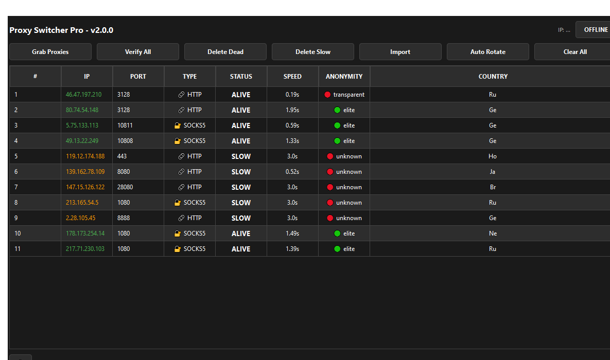

# Proxy Switcher Pro

Инструмент для управления прокси на Windows: сбор из открытых источников, массовая проверка, применение на уровне системы, авторотация.



## Возможности

- **Сбор прокси** из 17 источников (HTTP, SOCKS4, SOCKS5) — параллельно, ~300 прокси за 3 секунды
- **Проверка прокси** в несколько потоков: статус, скорость, анонимность (elite / anonymous / transparent), страна
- **Реальная проверка SOCKS** через PySocks — подтверждается, что порт работает по протоколу SOCKS, а не просто открыт
- **Фолбэк проверочных сервисов** — если httpbin.org недоступен, проверка автоматически идёт через запасные сервисы
- **Страны через batch-API** — все IP определяются за пару запросов (до 100 IP за запрос) с кэшем, без лимитов и тормозов
- **Применение на уровне системы Windows** — прокси включается одной кнопкой (реестр + мгновенное применение без перезагрузки)
- **Авторотация** — автоматическая смена прокси каждые N секунд
- **Системный трей** — сворачивание в трей при закрытии: прокси продолжает работать в фоне, управление из меню значка (отключается в настройках)
- **Поиск и фильтр** — живой поиск по IP/стране/типу/статусу + галочка «только живые»
- **Экспорт** — список прокси в txt (`user:pass@ip:port` для прокси с авторизацией, SOCKS — как `socks5://ip:port`)
- **Поддержка прокси с авторизацией** — парсятся форматы `user:pass@ip:port` и `socks5://ip:port` (и при сборе, и при импорте)
- **3 темы оформления** — тёмная, светлая, синяя
- **2 языка интерфейса** — русский и английский, переключаются в настройках без перезапуска
- **Избранное**, копирование в буфер, удаление мёртвых и медленных прокси
- **Логирование** через loguru с ротацией файлов

## Установка

Требуется Python 3.8+.

```bash
pip install -r requirements.txt
```

> Для проверки SOCKS-прокси нужен пакет `pysocks` — он уже указан в requirements.txt.

## Запуск

```bash
python proxy_switcher.py
```

## Использование

| Кнопка | Что делает |
|--------|-----------|
| Собрать прокси | Параллельный сбор из всех источников |
| Проверить все | Массовая проверка: статус, скорость, анонимность, страна |
| Удалить мертвые | Удалить прокси со статусом DEAD |
| Удалить медленные | Удалить прокси медленнее заданного порога |
| Импорт | Добавить свои прокси (`IP:PORT`, `socks5://IP:PORT`, `user:pass@IP:PORT`, дубликаты пропускаются) |
| Экспорт | Сохранить список в txt (с авторизацией — `user:pass@ip:port`, SOCKS — `socks5://ip:port`) |
| Авторотация | Автоматическая смена прокси по таймеру |
| Очистить все | Удалить все прокси из списка |

- **Двойной клик** по прокси — включить/выключить
- **Правый клик** — избранное, копирование IP:Port
- **Строка поиска** над таблицей — фильтр по IP/стране/типу/статусу + галочка «только живые»
- **⚙ Настройки** (внизу слева) — тема, язык, сворачивание в трей
- **Закрытие окна** — сворачивание в трей (прокси продолжает работать); полный выход — правый клик по значку в трее → Выход

## Источники прокси

Программа собирает прокси из 17 источников, включая:

- [ProxyScrape](https://proxyscrape.com) — API
- [free-proxy-list.net](https://free-proxy-list.net) / [sslproxies.org](https://www.sslproxies.org)
- Открытые списки GitHub: [TheSpeedX](https://github.com/TheSpeedX/PROXY-List), [monosans](https://github.com/monosans/proxy-list), [proxifly](https://github.com/proxifly/free-proxy-list), [jetkai](https://github.com/jetkai/proxy-list) и другие

## Файлы

- `proxy_switcher.py` — основное приложение
- `import.py` — модуль импорта прокси
- `requirements.txt` — зависимости

## Где хранятся данные

`~/Documents/ProxySwitcher/`:

- `proxies.json` — список прокси
- `settings.json` — настройки (тема, язык, авторотация)
- `logs/` — логи

## Платформы

- **Windows** — полная поддержка, включая системный прокси
- **Linux/macOS** — GUI работает, системный прокси недоступен

## ⚠️ Дисклеймер

Программа предназначена для легального использования: тестирования своих сервисов, обхода региональных ограничений там, где это не запрещено, и обучения. Публичные прокси по своей природе небезопасны — не передавайте через них пароли и чувствительные данные.

## Лицензия

MIT
